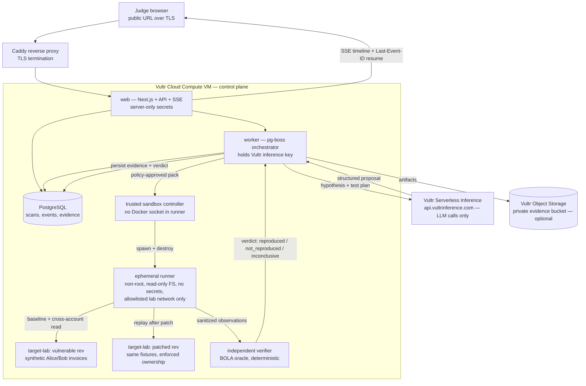

# HighCastle Hackathon Architecture (Challenge 1)

All agent LLM calls use **Vultr Serverless Inference**. The control plane,
worker, database, sandbox, and synthetic target all run on a **Vultr Cloud
Compute VM**. Execution is confined to disposable runners against an owned
synthetic invoice lab; an independent deterministic oracle — never the model
— decides the verdict.

## Events, SSE resume, and browser UI

Scan progress is persisted as sequenced `scan_events` rows in PostgreSQL
before publish. The browser timeline subscribes over authenticated SSE
and rehydrates with `Last-Event-ID` after disconnect — refresh or
restart loses nothing. Routes: landing → controlled demo → workspace
dashboard → scan wizard → live scan view → finding + fix prompt →
before/after replay comparison. UI never invents numbers: every row
links to its stored attempt, evidence, or replay record.

## Data-flow rules (enforced, not advisory)

| # | Rule | Enforced by |
|---|---|---|
| 1 | Only the worker talks to Vultr Serverless Inference | server-only key; runner has no credentials, no egress to inference |
| 2 | Model output is untrusted hypotheses only | `ModelProposalSchema` validation; enumerated `bola-invoice-v1` pack |
| 3 | Policy gate is deterministic | scope hash, allowlisted target alias, budget caps; LLM cannot grant permissions |
| 4 | Verdict comes from the oracle, never the model | fixture-ownership comparison on observed responses |
| 5 | Runner is disposable and secret-free | non-root, read-only FS, CPU/memory/pid/time limits, restricted network, verified destroy |
| 6 | Secrets never reach the browser, runner, logs, or repo | server-only env vars; redaction at boundaries; audit events |

## Vultr services in scope

| Service | Role | Status |
|---|---|---|
| Cloud Compute VM | web, worker, Postgres, lab, sandbox controller | deployed by L19 (`infra/docker/deploy`) |
| Serverless Inference | all agent LLM calls (`glm-5.3-flash`, verified live 2026-11-07) | proven via real smoke; evidence in `evidence-checklist.md` |
| Managed PostgreSQL or self-hosted Postgres on the VM | durable scan/event/evidence store | per `infra/vultr/ENVIRONMENT.md` |
| Object Storage (optional) | private evidence artifacts | fallback is private VM volume with documented limits |

Public URL, demo video, and end-to-end replay evidence land only after the
integration gate passes; until then every unverified claim in submission
materials is labelled pending.
